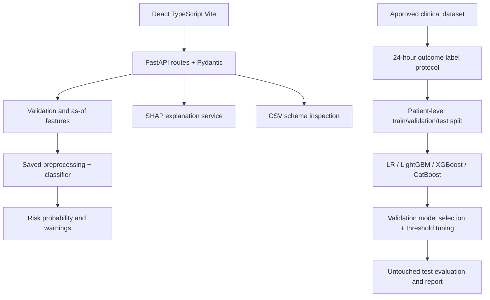

# Explainable and Dynamic Machine Learning Framework for AKI Risk Prediction

**Research/education prototype only. Not for diagnosis or treatment.** The `--demo` option generates synthetic software-test data; demo metrics are not clinical evidence. No real patient data are included.

## Architecture


## Data protocol
Candidate columns include `patient_id`, `timestamp`, demographics, labs, vitals, `aki_onset_timestamp`, and `followup_until`; inspect actual dataset columns rather than assuming them. `label_generation.py` builds a 24-hour label and a separate 24–48-hour label. A 24-hour row is positive when AKI onset satisfies `t < onset <= t + 24 hours`; negative only if follow-up is known through `t+24h` and no onset occurs in that window. Prevalent AKI and inadequately followed rows are excluded. Outcome fields never enter predictors. AKI onset must be derived using a documented, clinically reviewed definition such as KDIGO; a row-level `aki_label` is not a substitute for an onset timestamp.

## Windows PowerShell setup
Backend from project root:
```powershell
py -3.12 -m venv .venv
.\.venv\Scripts\Activate.ps1
python -m pip install --upgrade pip
pip install -r backend\requirements.txt
python -m backend.app.ml.train --demo
uvicorn backend.app.main:app --reload --host 127.0.0.1 --port 8000
python -m backend.app.ml.train --csv ".\aki_synthetic_dataset\aki_synthetic_longitudinal.csv" --target target_24h
```
Second terminal:
```powershell
cd frontend
npm install
npm run dev
```
Tests from root: `python -m pytest backend/tests -q`; frontend: `cd frontend; npm run test`; production build: `npm run build`.

## API example
`POST /predict`
```json
{"age":67,"sex":"female","creatinine":1.1,"baseline_creatinine":0.8,"bun":24,"egfr":62,"heart_rate":92,"systolic_bp":118,"diastolic_bp":72,"sodium":138,"potassium":4.2,"bicarbonate":23,"urine_output_ml_6h":null,"comorbidities":["diabetes"]}
```
Response schema includes `risk_probability`, `risk_level`, `threshold`, `model_name`, `prediction_timestamp`, `dataset_mode`, and `warnings`. Any sample probability is illustrative, not measured performance.

## Workflow
1. Run `python -m backend.app.ml.train --demo` to test software wiring only.
2. Inspect a permitted, de-identified dataset using `/validate-dataset`.
3. Create labels from onset/follow-up timestamps: `python -m backend.app.ml.label_generation --csv data\observations.csv --out data\aki_labeled.csv --horizon 24h`.
4. Run `python -m backend.app.ml.train --csv data\aki_labeled.csv`. CSV must contain `patient_id` and reviewed `target_24h`; if timestamped repeated observations are present, past-only rolling features are generated.
5. Model candidates are Logistic Regression, LightGBM, XGBoost, and CatBoost when compatible dependencies are available. Selection and threshold tuning use validation data only; the test set is evaluated after selection.
6. To benchmark a GRU on true repeated time-series data, install a compatible PyTorch build and run `python -m backend.app.ml.train_gru --csv data\aki_labeled.csv --target target_24h`. GRU is a research benchmark, not the live API model.
7. Submit admission features on Patient Input; submit timestamped observations on Dynamic Prediction. Dynamic predictions use past-only rolling features and show a chronological risk history.
8. SHAP values are model associations, not causal evidence.

## Security and limitations
Uploads are CSV-only, size-limited, inspected in memory and not saved or trained automatically. CORS defaults to localhost Vite origins; configure `AKI_FRONTEND_ORIGINS` for another origin. Do not enter identifiers. Follow dataset licenses, access agreements, privacy law and institutional review rules. No prospective validation is claimed; external validation requires an independent eligible dataset.

## Final-year report outline
Abstract; Introduction; Problem Statement; Objectives; Literature Review; Dataset/Privacy; Methodology; Label Protocol; Patient-Level Splitting; Model Development; Evaluation; Explainability; Implementation; Results; Limitations; Conclusion; Future Work; References.
